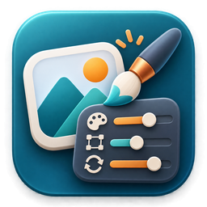
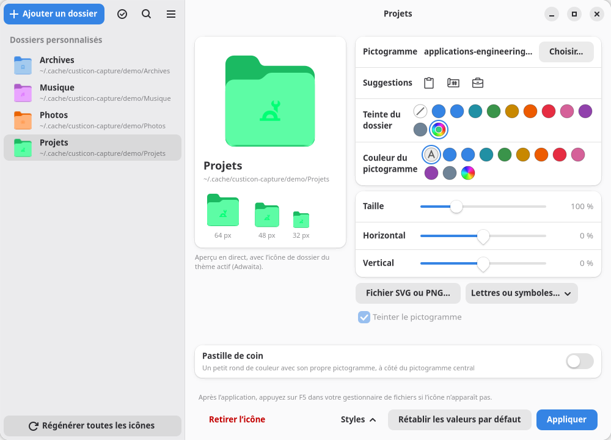

<div align="center">



# Custicon

**Un pictogramme sur l’icône de vos dossiers, dans votre environnement de bureau.**

*Vos dossiers, reconnaissables au premier coup d’œil.*

[](COPYING)
[](https://www.gnome.org)
[](https://pygobject.gnome.org)
[](https://github.com/Gor3pig/Custicon/releases/latest)

[English](README.md) · **Français**

[Site](https://gor3pig.github.io/Custicon/fr/) · [Guide d’utilisation](help/fr/README.md) · [Fonctions](#fonctions) · [Principes](#principes) · [Installation](#installation) · [Contribuer](#contribuer)



</div>

---

## Qu’est-ce que Custicon ?

Votre environnement de bureau affiche les dossiers Documents, Musique ou Images avec un petit pictogramme au centre.
**Custicon permet de faire la même chose pour n’importe quel dossier.**
Le pictogramme est posé sur la vraie icône de dossier de votre thème d’icônes actuel, et le contenu de vos dossiers n’est jamais touché.

## Fonctions

<table>
<tr>
<td width="33%" valign="top">

**Choisir**<br>Plus de 6 000 pictogrammes : Phosphor, émoji, logos de marques, votre thème, votre fichier, vos propres jeux d’icônes SVG ou des lettres. Des suggestions suivent le nom du dossier.

</td>
<td width="33%" valign="top">

**Ajuster**<br>Couleur choisie dans une palette, taille et position. Faites glisser le pictogramme sur l’aperçu, la molette le redimensionne.

</td>
<td width="33%" valign="top">

**Teinter**<br>Donnez au dossier lui-même la couleur de votre choix, ou l’accent de votre système.

</td>
</tr>
<tr>
<td width="33%" valign="top">

**Grouper**<br>Personnalisez plusieurs dossiers d’un coup, avec le même pictogramme et le même aspect.

</td>
<td width="33%" valign="top">

**Régénérer**<br>Toutes les icônes d’un coup, après un changement de thème ou de couleur d’accent.

</td>
<td width="33%" valign="top">

**Annuler**<br>Une icône retirée rend au dossier exactement celle qu’il avait avant.

</td>
</tr>
<tr>
<td width="33%" valign="top">

**Pastille**<br>Un petit rond de couleur avec son propre pictogramme dans un coin du dossier, à côté du pictogramme central.

</td>
<td width="33%" valign="top">

**Sauvegarder**<br>Tous vos dossiers, styles et favoris dans un seul fichier, restauré en un clic sur n’importe quel ordinateur.

</td>
<td width="33%" valign="top">

**Partout**<br>GNOME, KDE Plasma, Cinnamon, MATE ou LXQt : la bonne méthode est choisie automatiquement.

</td>
</tr>
</table>

<p align="center"><b><a href="help/fr/README.md">Lire le guide d’utilisation →</a></b><br>Tout ce que Custicon sait faire, pas à pas.</p>

## Bureaux pris en charge

| Bureau | Gestionnaire de fichiers | État |
|---|---|---|
| GNOME, Budgie | Fichiers (Nautilus) | Pris en charge |
| Cinnamon | Nemo | Pris en charge |
| MATE | Caja | Pris en charge |
| KDE Plasma | Dolphin | Pris en charge (petit fichier caché `.directory` dans le dossier, retiré avec l’icône) |
| LXQt | PCManFM-Qt | Pris en charge (idem) |
| Xfce, LXDE, COSMIC | Thunar, PCManFM, COSMIC Files | Non pris en charge : ces gestionnaires ne savent pas afficher d’icônes de dossier personnalisées |

Le mode est choisi automatiquement. Chaque ligne a été vérifiée avec le vrai gestionnaire de fichiers ; les autres bureaux (Pantheon, Deepin) ne sont pas vérifiés.

## Principes

**Le contenu de vos dossiers n’est jamais modifié** · **Entièrement local, sans réseau** · **Fidèle à votre thème** · **Réversible**

## Installation

### 1. Préparer Flatpak

Fedora, Linux Mint, Pop!_OS et beaucoup d’autres distributions fournissent déjà Flatpak. Sur Ubuntu et
quelques autres, suivez d’abord le [guide officiel de votre distribution](https://flathub.org/setup),
puis redémarrez votre session.

### 2. Installer Custicon

Ouvrez [custicon.flatpakref](https://gor3pig.github.io/Custicon/custicon.flatpakref) avec l’application Logiciels, ou
lancez cette commande :

```sh
flatpak install --user https://gor3pig.github.io/Custicon/custicon.flatpakref
```

Flatpak peut proposer d’ajouter Flathub pour installer la plateforme GNOME 51.

### 3. Rester à jour

Custicon se met à jour comme vos autres applications : l’application Logiciels propose chaque nouvelle version, et chaque mise à jour est signée.
Le fichier `.flatpak` de chaque version est aussi joint à sa [publication](https://github.com/Gor3pig/Custicon/releases).
D’autres options (fichier de publication, désinstallation, permissions) sont dans [docs/install.md](docs/install.md) (en anglais).

Custicon s’exécute dans le bac à sable Flatpak avec un accès à votre dossier personnel, nécessaire pour connaître
le vrai chemin de vos dossiers. Il n’a aucun accès au réseau et ne modifie jamais le contenu de vos dossiers.

## Guide d’utilisation

Le [guide d’utilisation](help/fr/README.md) vous accompagne dans tout ce que Custicon sait faire. Dans l’application, il
s’ouvre aussi depuis le menu principal ou avec <kbd>F1</kbd>.

## Contribuer

Custicon est un logiciel libre et toute aide est la bienvenue : signalements, idées, traductions et code.
[docs/development.md](docs/development.md) (en anglais) explique comment compiler Custicon et proposer une modification,
et [docs/architecture.md](docs/architecture.md) donne une vue d’ensemble du code.

## Licences

Custicon est un logiciel libre publié sous [GNU GPL v3 ou ultérieure](COPYING).

Les pictogrammes fournis gardent leurs propres licences :

- Phosphor Icons, dans `src/custicon/phosphor/` : © 2023 Phosphor Icons, [licence MIT](src/custicon/phosphor/LICENSE).
- Fluent Emoji (monochrome), dans `src/custicon/emoji/` : © Microsoft Corporation, [licence MIT](src/custicon/emoji/LICENSE). Leurs noms français viennent du CLDR d’Unicode, sous [Unicode License v3](src/custicon/emoji/LICENSE-CLDR).
- Simple Icons, dans `src/custicon/brands/` : [CC0 1.0](src/custicon/brands/LICENSE). Les marques et logos restent la propriété de leurs détenteurs respectifs (voir l’[avertissement](src/custicon/brands/DISCLAIMER)).
