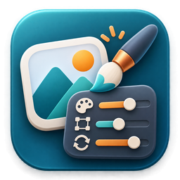

<div align="center">



# Custicon

**A pictogram on the icon of your folders, in Nautilus.**

[](COPYING)
[](https://www.gnome.org)
[](https://pygobject.gnome.org)
[](https://flatpak.org)

**English** · [Français](README.fr.md)

[Website](https://gor3pig.github.io/Custicon/) · [User guide](help/en/README.md) · [Features](#features) · [Principles](#principles) · [Installation](#installation) · [Development](#development)


</div>

---

## What is Custicon?

Nautilus shows the Documents, Music or Pictures folders with a small pictogram in the middle.
**Custicon lets you do the same for any folder.**

The pictogram is placed on the **real folder icon of your current icon theme**, not on an imitation.
If you change theme, a single action updates all your icons. You can also tint the folder itself.

## Features

<table>
<tr>
<td width="33%" valign="top">

**Choose**<br>A pictogram from your theme or from the bundled Phosphor set, found by name (in English or French), or your own SVG or PNG file.

</td>
<td width="33%" valign="top">

**Adjust**<br>Automatic or free color, size and position, with a live preview.

</td>
<td width="33%" valign="top">

**Tint**<br>Give the folder itself the color you want, or the accent color of your system.

</td>
</tr>
<tr>
<td width="33%" valign="top">

**Remove**<br>The folder gets back exactly the icon it had before.

</td>
<td width="33%" valign="top">

**Regenerate**<br>All icons at once, after a change of theme or accent color.

</td>
<td width="33%" valign="top">

**Respect**<br>The content of your folders is never modified.

</td>
</tr>
</table>

<p align="center"><b><a href="help/en/README.md">Read the user guide →</a></b><br>Everything Custicon can do, step by step.</p>

## Principles

**No file added to your folders** · **Fully local, no network** · **Faithful to your theme** · **Reversible**

The icon is saved in the GVfs metadata that Nautilus already reads, and the generated image is stored
in the data space of the application. Nothing is written into the folder itself.

## Installation

Custicon is distributed as a Flatpak package.

### From the Flatpak repository (recommended)

Fedora, Linux Mint, Pop!_OS and many other distributions ship Flatpak already. On Ubuntu and a few others,
follow the [official guide for your distribution](https://flathub.org/setup) first, then restart your session.

Open [custicon.flatpakref](https://gor3pig.github.io/Custicon/custicon.flatpakref) with the Software app, or run this command:

```sh
flatpak install --user https://gor3pig.github.io/Custicon/custicon.flatpakref
flatpak run io.github.gor3pig.Custicon
```

Flatpak may offer to add Flathub to install the GNOME 51 platform. Without the `--user` option, the installation is system-wide.

Custicon is then updated like your other apps: the Software app offers each new version, or run `flatpak update`.
Every update is signed.

### From a release file

The `custicon-X.Y.Z.flatpak` file attached to each [release](https://github.com/Gor3pig/Custicon/releases) is an alternative.
It is not updated by itself:

```sh
sha256sum -c custicon-X.Y.Z.flatpak.sha256
flatpak install --user custicon-X.Y.Z.flatpak
```

If you installed Custicon this way and want automatic updates, uninstall it with `flatpak uninstall io.github.gor3pig.Custicon`
and install it again from the `.flatpakref` file above. Your styles and customized folders are kept, as long as you do not add `--delete-data`.

### From the sources

You need `flatpak`, `flatpak-builder` and the GNOME 51 platform from Flathub:

```sh
flatpak install flathub org.gnome.Platform//51 org.gnome.Sdk//51
git clone https://github.com/Gor3pig/Custicon.git
cd Custicon
flatpak-builder --user --install --disable-rofiles-fuse --force-clean build-dir \
    build-aux/io.github.gor3pig.Custicon.json
flatpak run io.github.gor3pig.Custicon
```

The package is built from the files of the git repository (the last commit of the `main` branch).

### Uninstall

```sh
flatpak uninstall --user io.github.gor3pig.Custicon
```

Before uninstalling, use **Remove Icon** on each customized folder: the generated images are stored in the
data of the application and disappear with it if you add the `--delete-data` option.

### Permissions

Custicon runs in the Flatpak sandbox and only asks for what it needs: the display, **read-only** access to your home
folder (to see the real path of your folders and read your icon themes) and communication with the GVfs metadata
service, which writes the icon outside the sandbox. The content of your folders therefore cannot be modified by Custicon.
It has no network access. Details are in [docs/architecture.md](docs/architecture.md) (in French).

The app store flags this permission because it covers all your files in read mode. It is required: without the real
path of the folder, GVfs saves the icon in a tree that Nautilus does not read. If access is missing, Custicon says so
and gives the command `flatpak override --user --filesystem=home:ro io.github.gor3pig.Custicon`.
If the message comes back, a permission override may be removing the access: see the
[guide](help/en/README.md#questions-and-answers).

## Usage

The [user guide](help/en/README.md) describes every step. In short:

1. **Add Folder** (Ctrl+O) and choose the folder to customize.
2. Choose a pictogram and adjust the appearance, watching the preview.
3. **Apply**, then press **F5** in the Nautilus window to see the change.

You can also open a folder straight from Nautilus (right click, **Open With Custicon**), save styles, tint the folder,
use the accent color of the system, or put letters as a pictogram. The guide covers it all, and **F1** opens it
from the application.

Nautilus does not refresh its icons by itself: F5 is needed after each apply, removal or regeneration.

## Development

Custicon is written in Python with GTK4 and Libadwaita. [docs/architecture.md](docs/architecture.md) (in French)
presents the organization of the code. The `check.sh` script runs every check (tests, validation of the
application files, translations):

```sh
./check.sh
```

It needs Python 3, PyGObject, GTK4, Libadwaita, librsvg, GVfs, `gettext`, `gpg`, `desktop-file-validate`
and `appstreamcli`. The interface tests use `gtk4-broadwayd`, shipped with GTK4, and a session bus
(`dbus-run-session` is used when there is none).

Commit messages are written in English. Releases are described in [docs/publication.md](docs/publication.md).
The project is developed on Fedora with GNOME 50.

## Licenses

Custicon is free software released under the [GNU GPL v3 or later](COPYING).

The Phosphor pictograms bundled in `src/custicon/phosphor/` are © 2023 Phosphor Icons, under the
[MIT license](src/custicon/phosphor/LICENSE).
