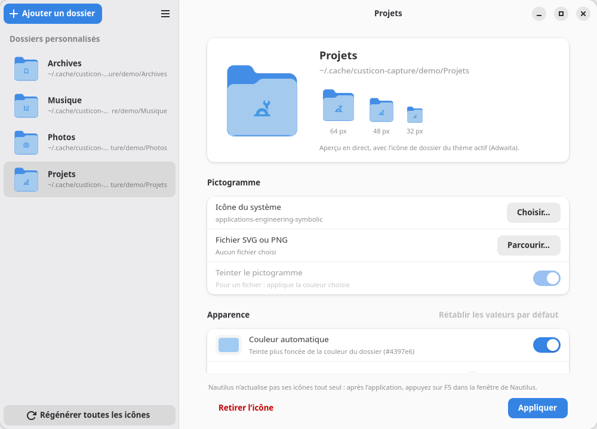

<div align="center">


# Custicon

**Un pictogramme sur l’icône de vos dossiers, dans Nautilus.**

Licence GPL-3.0 ou ultérieure · GNOME · GTK4 et Libadwaita · Flatpak

[Guide d’utilisation](docs/guide.md) · [Fonctions](#fonctions) · [Principes](#principes) · [Installation](#installation) · [Développement](#développement)



</div>

---

## Qu’est-ce que Custicon ?

Nautilus affiche les dossiers Documents, Musique ou Images avec un petit pictogramme au centre.
**Custicon permet de faire la même chose pour n’importe quel dossier.**

Le pictogramme est posé sur la **vraie icône de dossier de votre thème d’icônes actuel**, pas sur une
imitation. Si vous changez de thème, une seule action met à jour toutes vos icônes.

## Fonctions

<table>
<tr>
<td width="33%" valign="top">

**Choisir**<br>Un pictogramme de votre thème, trouvé par son nom, ou votre propre fichier SVG ou PNG.

</td>
<td width="33%" valign="top">

**Régler**<br>Couleur automatique ou libre, taille et position, avec un aperçu en direct.

</td>
<td width="33%" valign="top">

**Retirer**<br>Le dossier retrouve exactement l’icône qu’il avait avant.

</td>
</tr>
<tr>
<td width="33%" valign="top">

**Régénérer**<br>Toutes les icônes d’un coup, après un changement de thème.

</td>
<td width="33%" valign="top">

**Suivre**<br>La liste de vos dossiers personnalisés, avec l’état de chacun.

</td>
<td width="33%" valign="top">

**Respecter**<br>Le contenu de vos dossiers n’est jamais modifié.

</td>
</tr>
</table>

## Principes

**Aucun fichier ajouté dans vos dossiers** · **Entièrement local, sans réseau** · **Fidèle à votre thème** · **Réversible**

L’icône est enregistrée dans les métadonnées GVfs que Nautilus lit déjà, et l’image générée est rangée
dans l’espace de données de l’application. Rien n’est écrit dans le dossier lui-même.

## Installation

Custicon se distribue sous forme de paquet Flatpak.

### Depuis une release (le plus simple)

Téléchargez le fichier `custicon-X.Y.Z.flatpak` joint à une [release](https://github.com/Gor3pig/Custicon/releases)
(le dépôt est privé : connectez-vous d’abord à GitHub), puis :

```sh
sha256sum -c custicon-X.Y.Z.flatpak.sha256
flatpak install --user custicon-X.Y.Z.flatpak
flatpak run io.github.gor3pig.Custicon
```

Flatpak propose d’ajouter Flathub pour installer l’environnement GNOME 51 si besoin. Sans l’option `--user`,
l’installation est faite pour tout le système.

### Depuis les sources

Il faut `flatpak`, `flatpak-builder` et l’environnement GNOME 51 de Flathub :

```sh
flatpak install flathub org.gnome.Platform//51 org.gnome.Sdk//51
git clone https://github.com/Gor3pig/Custicon.git
cd Custicon
flatpak-builder --user --install --disable-rofiles-fuse --force-clean build-dir \
    build-aux/io.github.gor3pig.Custicon.json
flatpak run io.github.gor3pig.Custicon
```

Le paquet est construit à partir des fichiers du dépôt git (le dernier commit de la branche `main`).

### Désinstaller

```sh
flatpak uninstall --user io.github.gor3pig.Custicon
```

Avant de désinstaller, utilisez **Retirer l’icône** pour chaque dossier personnalisé : les images
générées sont stockées dans les données de l’application et disparaissent avec elles
si vous ajoutez l’option `--delete-data`.

### Permissions demandées

Custicon fonctionne dans le bac à sable Flatpak et ne demande que ce dont il a besoin :
l’affichage, l’accès à votre dossier personnel (pour écrire les métadonnées sur le vrai chemin de
vos dossiers et lire vos thèmes d’icônes) et la communication avec le service de métadonnées de GVfs.
Il n’a pas accès au réseau. Le détail est dans [docs/architecture.md](docs/architecture.md).

## Utilisation

Le [guide d’utilisation](docs/guide.md) décrit chaque étape. En résumé :

1. **Ajouter un dossier** (Ctrl+O) et choisir le dossier à personnaliser.
2. Choisir un pictogramme et régler l’apparence, en regardant l’aperçu.
3. **Appliquer**, puis appuyer sur **F5** dans la fenêtre de Nautilus pour voir le changement.

Nautilus n’actualise pas ses icônes tout seul : F5 est nécessaire après chaque application, retrait ou régénération.

## Développement

Custicon est écrit en Python avec GTK4 et Libadwaita. [docs/architecture.md](docs/architecture.md)
présente l’organisation du code. Le script `check.sh` lance tous les contrôles (tests, validation
des fichiers de l’application, traductions) :

```sh
./check.sh
```

Il demande Python 3, PyGObject, GTK4, Libadwaita, librsvg, GVfs, `gettext`, `desktop-file-validate`
et `appstreamcli`. Les tests de l’interface utilisent `gtk4-broadwayd`, fourni avec GTK4, et un bus de session
(`dbus-run-session` est utilisé s’il n’y en a pas).

Le projet est développé sous Fedora avec GNOME 50.

## Licence

Custicon est un logiciel libre publié sous licence [GNU GPL v3 ou ultérieure](COPYING).
