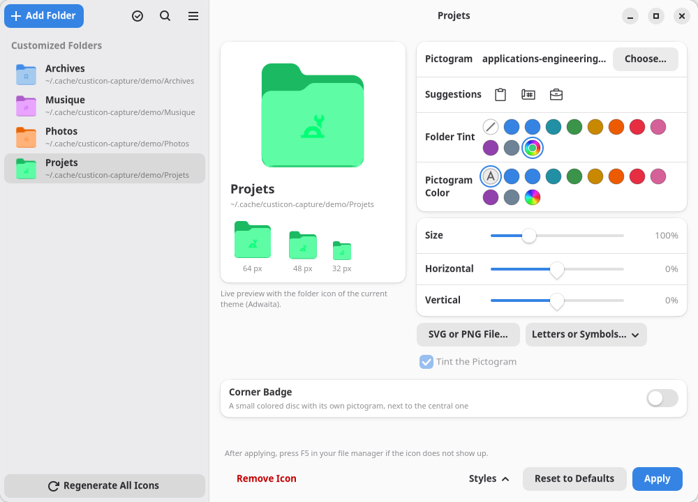

<div align="center">


# Custicon

**A pictogram on the icon of your folders, in your desktop environment.**

*Your folders, recognizable at a glance.*

[](COPYING)
[](https://www.gnome.org)
[](https://pygobject.gnome.org)
[](https://github.com/Gor3pig/Custicon/releases/latest)

**English** · [Français](README.fr.md)

[Website](https://gor3pig.github.io/Custicon/) · [User guide](help/en/README.md) · [Features](#features) · [Principles](#principles) · [Installation](#installation) · [Contributing](#contributing)



</div>

---

## What is Custicon?

Your desktop environment shows the Documents, Music or Pictures folders with a small pictogram in the middle.
**Custicon lets you do the same for any folder.**
The pictogram is placed on the real folder icon of your current icon theme, and the content of your folders is never touched.

## Features

<table>
<tr>
<td width="33%" valign="top">

**Choose**<br>Over 6,000 pictograms: Phosphor, emoji, brand logos, your theme, your own file, your own sets of SVG icons or letters. Suggestions follow the folder name.

</td>
<td width="33%" valign="top">

**Adjust**<br>Color from a palette, size and position. Drag the pictogram on the preview, scroll to resize it.

</td>
<td width="33%" valign="top">

**Tint**<br>Give the folder itself the color you want, or the accent color of your system.

</td>
</tr>
<tr>
<td width="33%" valign="top">

**Group**<br>Customize several folders at once, with the same pictogram and look.

</td>
<td width="33%" valign="top">

**Regenerate**<br>All icons at once, after a change of theme or accent color.

</td>
<td width="33%" valign="top">

**Undo**<br>A removed icon gives the folder back exactly the one it had before.

</td>
</tr>
<tr>
<td width="33%" valign="top">

**Badge**<br>A small colored disc with its own pictogram in a corner of the folder, next to the central one.

</td>
<td width="33%" valign="top">

**Back up**<br>All your folders, styles and favorites in one file, restored in one click on any computer.

</td>
<td width="33%" valign="top">

**Everywhere**<br>GNOME, KDE Plasma, Cinnamon, MATE or LXQt: the right method is chosen automatically.

</td>
</tr>
</table>

<p align="center"><b><a href="help/en/README.md">Read the user guide →</a></b><br>Everything Custicon can do, step by step.</p>

## Supported desktops

| Desktop | File manager | Status |
|---|---|---|
| GNOME, Budgie | Files (Nautilus) | Supported |
| Cinnamon | Nemo | Supported |
| MATE | Caja | Supported |
| KDE Plasma | Dolphin | Supported (small hidden `.directory` file in the folder, removed with the icon) |
| LXQt | PCManFM-Qt | Supported (same) |
| Xfce, LXDE, COSMIC | Thunar, PCManFM, COSMIC Files | Not supported: these file managers cannot show custom folder icons |

The mode is chosen automatically. Each line was checked with the real file manager; other desktops (Pantheon, Deepin) are not verified.

## Principles

**Your folders' content is never changed** · **Fully local, no network** · **Faithful to your theme** · **Reversible**

## Installation

### 1. Set up Flatpak

Fedora, Linux Mint, Pop!_OS and many other distributions ship Flatpak already. On Ubuntu and a
few others, follow the [official guide for your distribution](https://flathub.org/setup) first,
then restart your session.

### 2. Install Custicon

Open [custicon.flatpakref](https://gor3pig.github.io/Custicon/custicon.flatpakref) with the Software app, or
run this command:

```sh
flatpak install --user https://gor3pig.github.io/Custicon/custicon.flatpakref
```

Flatpak may offer to add Flathub to install the GNOME 51 platform.

### 3. Stay up to date

Custicon is updated like your other apps: the Software app offers each new version, and every update is signed.
The `.flatpak` file of each version is also attached to its [release](https://github.com/Gor3pig/Custicon/releases).
More options (release file, uninstall, permissions) are in [docs/install.md](docs/install.md).

Custicon runs in the Flatpak sandbox with access to your home folder, needed to know the real path of your folders.
It has no network access and never modifies the content of your folders.

## User guide

The [user guide](help/en/README.md) walks you through everything Custicon can do. In the app, it
also opens from the main menu or with <kbd>F1</kbd>.

## Contributing

Custicon is free software and help is welcome: bug reports, ideas, translations and code.
[docs/development.md](docs/development.md) explains how to build Custicon and submit a change,
and [docs/architecture.md](docs/architecture.md) (in French) gives an overview of the code.

## Licenses

Custicon is free software released under the [GNU GPL v3 or later](COPYING).

The bundled pictograms keep their own licenses:

- Phosphor Icons, in `src/custicon/phosphor/`: © 2023 Phosphor Icons, [MIT license](src/custicon/phosphor/LICENSE).
- Fluent Emoji (monochrome), in `src/custicon/emoji/`: © Microsoft Corporation, [MIT license](src/custicon/emoji/LICENSE). Their French names come from the Unicode CLDR, under the [Unicode License v3](src/custicon/emoji/LICENSE-CLDR).
- Simple Icons, in `src/custicon/brands/`: [CC0 1.0](src/custicon/brands/LICENSE). The brands and logos remain the trademarks of their respective owners (see the [disclaimer](src/custicon/brands/DISCLAIMER)).
