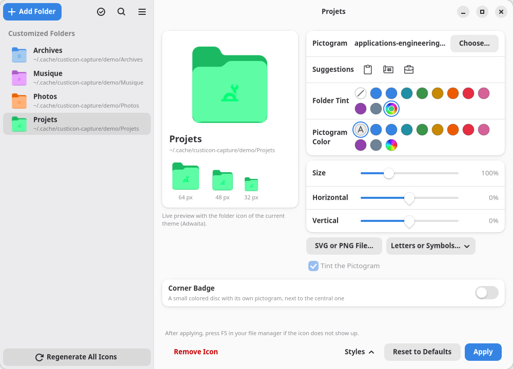
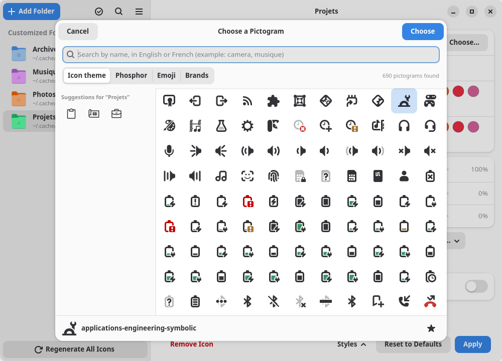
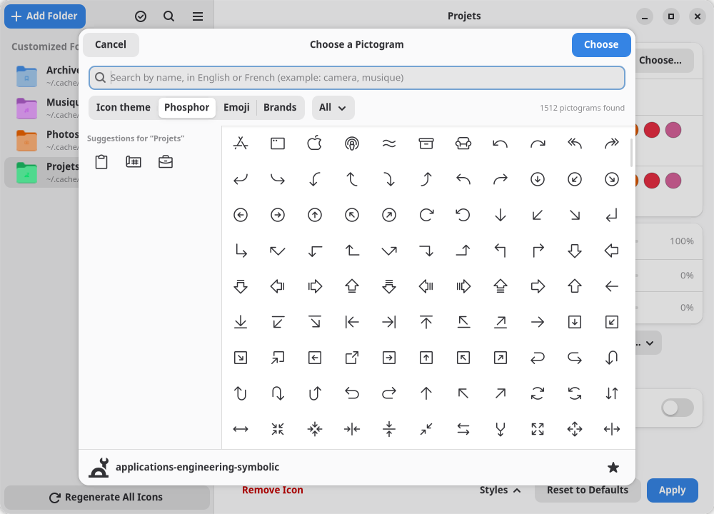
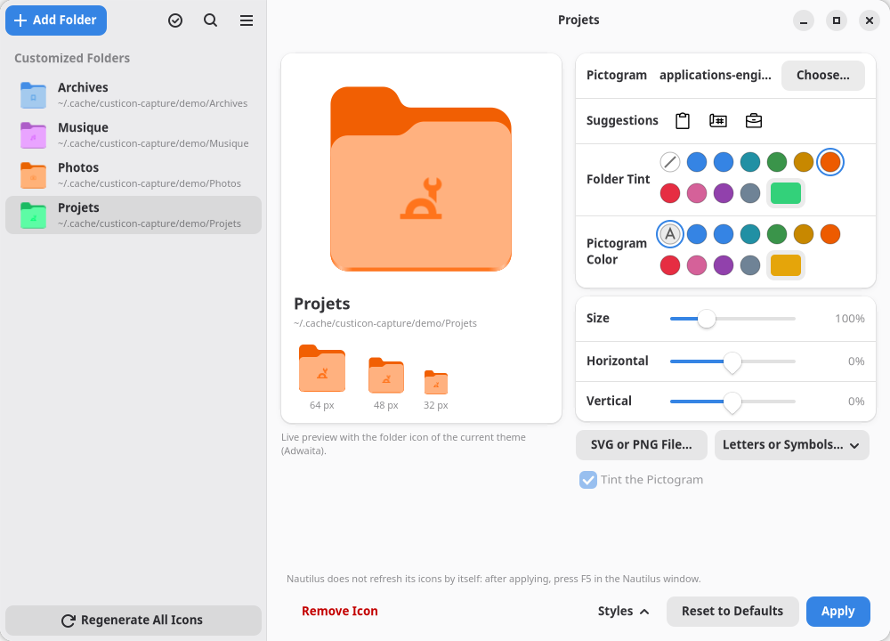
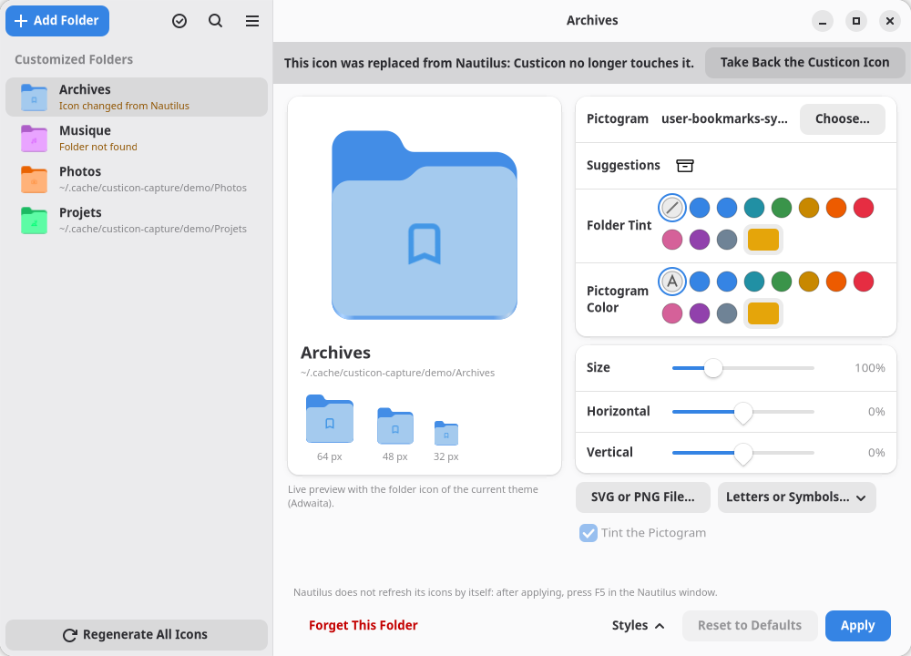

# Custicon user guide

**English** · [Français](../fr/README.md)

Custicon puts a pictogram on the folder icon of your theme, for the folders you choose, and can also tint the folder
itself. This guide describes every step.



## Contents

**Discover**
- [Getting started](#getting-started)
- [Choosing the pictogram](#choosing-the-pictogram)

**Use**
- [Adjusting the appearance](#adjusting-the-appearance)
- [Applying and seeing the result](#applying-and-seeing-the-result)
- [Managing your folders](#managing-your-folders)
- [Removing an icon](#removing-an-icon)
- [After a theme change](#after-a-theme-change)

**Go further**
- [Help, About and keyboard shortcuts](#help-about-and-keyboard-shortcuts)
- [Questions and answers](#questions-and-answers)

## Getting started

On first launch, the window offers to choose a folder. You can also use
**Add Folder** at the top left (Ctrl+O).

1. Choose the folder to customize. It must be inside your home folder.
2. The folder appears in the list on the left, with the folder icon of your theme.
3. The editor opens on the right. The **Apply** button stays disabled until a pictogram is chosen.

> [!NOTE]
> Choosing a folder changes nothing. Nothing is saved until you press **Apply**.

## Choosing the pictogram

Four possibilities, in the **Pictogram** group.

### A system icon or a Phosphor icon

**System Icon** > **Choose…** opens the list of pictograms. A switch at the top lets you go from the
**Icon theme** (the pictograms of your current theme) to **Phosphor** (a set of 1,500 pictograms shipped
with Custicon: animals, places, objects, symbols…).





- Type a word in the search field, in English or in French. The names are in English
  (for example `camera`, `music`, `folder`, `star`), but Custicon also knows French words
  (`maison`, `musique`, `étoile`, `photo`, `chat`, `voiture`…), ignoring accents and case.
  The search stays in place when you switch sets.
- Click a pictogram then **Choose**, or double-click it.
- If the current theme does not provide the requested icon, Custicon uses the Adwaita one.
- A Phosphor pictogram is shown with “(Phosphor)” after its name. It ships with Custicon: it does not depend on your
  theme and stays available after a theme change.

### A file

**SVG or PNG File** > **Browse…** lets you use your own image.

- **Tint the Pictogram** applies the chosen color to the image. For an SVG, the original colors are replaced;
  for a PNG, only the shape (the transparency) is kept.
- Turn the tint off to keep the original colors of the image.

### Letters or symbols

**Letters or Symbols** lets you type 1 to 3 characters (for example `Z`, `A1`, `é`) that serve as the pictogram.
They are drawn as vectors and tinted like any theme pictogram. A character the font cannot draw is refused with a message.
Choosing an icon or a file clears the text, and the other way round.

## Adjusting the appearance

The **Appearance** group sets the rendering. The preview at the top of the editor shows the result
at four sizes, with the folder icon of your current theme.



- **Folder Tint**: three choices.
  - **None**: the folder keeps the color of your icon theme.
  - **System Accent**: the folder takes the accent color chosen in the GNOME settings.
  - **Custom**: the swatch lets you pick the color yourself.

  The relief of the folder (its light and dark areas) is kept, and the theme file is never modified.
  A gray, a white or a black gives a desaturated folder rather than a vivid color.
- **Color** (of the pictogram): three choices.
  - **Automatic**: Custicon takes the color of the folder face, tint included, and derives a darker
    color from it, as the Documents or Music folders do.
  - **System Accent**: the accent color chosen in the GNOME settings. When you change it,
    a banner offers to regenerate the icons that follow it.
  - **Custom**: the swatch lets you pick the color yourself.
- **Size**: from 20% to 300% of the original size.
- **Horizontal Position** and **Vertical Position**: from -50% to +50%, from the center of the folder face.
- **Reset to Defaults** brings back no tint, the automatic color, and the original size and position.

The sliders move in steps of 0.5% (arrow keys; Page Up and Page Down move by 5%).
They widen with the window, which makes mouse adjustment more precise.

### Named styles

The **Styles** button (next to **Reset to Defaults**) saves the current appearance under a name
(folder tint, color, pictogram tint, size and positions, never the pictogram itself). A click on a style applies it
to the current folder; the trash icon deletes it. Styles can be exchanged between machines with
**Export Styles…** and **Import Styles…** in the main menu: an imported style replaces the one with the same name,
and invalid entries are skipped with a count.

### Settings kept for the next folders

At each **Apply**, Custicon remembers the chosen appearance: folder tint, color (automatic or not),
tint, size and positions. The next folder you add starts with these settings, which you can change
freely. The pictogram is never remembered, and folders already customized do not change.
**Reset to Defaults** always goes back to the original Custicon values.

## Applying and seeing the result

Press **Apply**. A message confirms the operation.

> [!IMPORTANT]
> **Nautilus does not refresh its icons by itself.** Press **F5** in the Nautilus window
> to see the change. The same gesture is needed after a removal or a regeneration.

## Managing your folders

The list on the left shows all the customized folders, in alphabetical order. Each folder can
show an alert:



| Alert | Meaning | What to do |
|---|---|---|
| Folder not found | The folder was deleted, renamed or moved. | **Find the Folder…** (choose its new location) or **Forget This Folder**. |
| Icon changed from Nautilus | You chose another icon in Nautilus. Custicon no longer touches it. | **Take Back the Custicon Icon**, or **Forget This Folder**. |
| Icon file missing | The generated image has disappeared. | **Regenerate the Icon**. |
| Metadata unreadable | The metadata of the folder cannot be read. | Try again or forget the folder. |

When the window becomes active again, the list is updated. Your current settings are not lost.

### Searching the list

The magnifier at the top of the list (or Ctrl+F) opens a search field: it filters folders by name or by path,
ignoring accents and case.

### Opening a folder from Nautilus

Right-click a folder in Nautilus, then **Open with Custicon**. You can also drag a folder onto the window,
or run `flatpak run io.github.gor3pig.Custicon /path/to/folder`. Only one folder is opened at a time,
and a file is refused. If Custicon is already running, the same window is reused.

## Removing an icon

**Remove Icon** asks for confirmation. The folder gets back the icon it had before Custicon:
no custom icon, or the one you chose yourself in Nautilus.
The content of the folder is never touched.

Right after a removal, a notification offers **Undo** for a few seconds: the icon is restored with
its settings, even if the pictogram file has disappeared in the meantime.

**Remove All Icons…** (main menu) does the same for every folder, after confirmation, and shows
a report. It is the right precaution before uninstalling Custicon with data removal.

**Forget This Folder** (for a folder that is missing or whose icon you changed) simply stops
tracking it, without changing the current icon.

## After a theme change

When you change the icon theme, the icons already placed keep the old folder. A banner “Some icons no longer match
your icon theme or accent color” then offers to regenerate them in one click.
**Regenerate All Icons** (button at the bottom of the list, or Ctrl+R) recomputes them with the new theme,
keeping your settings, folder tint included. A report tells what was updated, skipped or not found.
Folders whose icon you changed from Nautilus are skipped.

Then press F5 in Nautilus.

## Help, About and keyboard shortcuts

The main menu contains **Help** (F1 key), which opens this guide in the language of your desktop (English or French),
and **About Custicon**. The About dialog shows the version, what is new in this version (**What’s New**),
the support and issue links, the credits and the licenses, including the one of the Phosphor set.

| Shortcut | Action |
|---|---|
| Ctrl+O | Add a folder |
| Ctrl+R | Regenerate all icons |
| Ctrl+F | Search the list of folders |
| F1 | Open the help |
| Ctrl+Q | Quit |

## Questions and answers

**Why do I have to press F5?**
Nautilus reads custom icons when a folder is opened and does not watch for changes.
F5 reloads the content of the window.

**The folder icon is not the one of my theme.**
Custicon uses the `folder` icon of your current theme, following the inheritance between themes.
If your theme only provides a PNG, the result is a bitmap and may look less sharp at large sizes.

**The folder tint is not exactly the color I chose.**
The tint replaces the color of the folder while keeping its relief: light areas stay light and dark areas stay dark.
The result is therefore close to the chosen color, without being identical. A theme whose folder is very light or
very dark gives a paler or darker result.

**How do I back up my settings or copy them to another machine?**
Styles are exported from the main menu. The list of folders and the generated images are in
`~/.var/app/io.github.gor3pig.Custicon/data/custicon/`; since folder paths are specific to each machine,
the list is not meant to be copied as is.

**A letter or a symbol is refused?**
The Custicon font cannot draw this character (color emoji are not supported).
Try a letter, a digit or a common symbol.

**Where are the generated images stored?**
In the data space of the application (`~/.var/app/io.github.gor3pig.Custicon/data/custicon/`).
An uninstall with data removal erases them: remove the icons first.

**How is Custicon updated?**
If you installed it from `custicon.flatpakref`, the Software app offers each new version, or run `flatpak update`; updates are signed.
A copy installed from the `.flatpak` file of a release is not updated by itself: uninstall it (`flatpak uninstall io.github.gor3pig.Custicon`)
and install it again from the `.flatpakref` file, keeping your styles and customized folders as long as you do not add `--delete-data`.
The installation commands are in the [README](../../README.md#installation).

**Why does Custicon ask for access to my home folder?**
For Nautilus to see the icon, Custicon has to know the real path of the folder. It only asks for
**read** access to the home folder: the content of your folders cannot be modified by the application,
and it has no network access. The icon is saved by the GVfs service of your session, outside the sandbox.
The app store flags this permission because it covers all your files in read mode.

**Custicon says it cannot see my home folder.**
Access was removed or not granted. Allow it in Settings (Applications, then Custicon),
or run in a terminal:

```sh
flatpak override --user --filesystem=home:ro io.github.gor3pig.Custicon
```

then restart Custicon. If the message comes back, a permission override may be removing the access:
`flatpak override --user --show io.github.gor3pig.Custicon` (and `flatpak override --show io.github.gor3pig.Custicon`
for the system-wide override) lists them, and `flatpak override --user --reset io.github.gor3pig.Custicon` deletes
those of your user. The command `flatpak run --command=cat io.github.gor3pig.Custicon /.flatpak-info` shows what the
application really sees.

**Why can only folders inside the home folder be chosen?**
For Nautilus to see the icon, Custicon has to write to the real path of the folder. External
drives are not supported in this version.

**My folder is chosen but the icon does not appear in Nautilus.**
Press F5. If nothing changes, check whether the folder shows an alert in the Custicon list.
