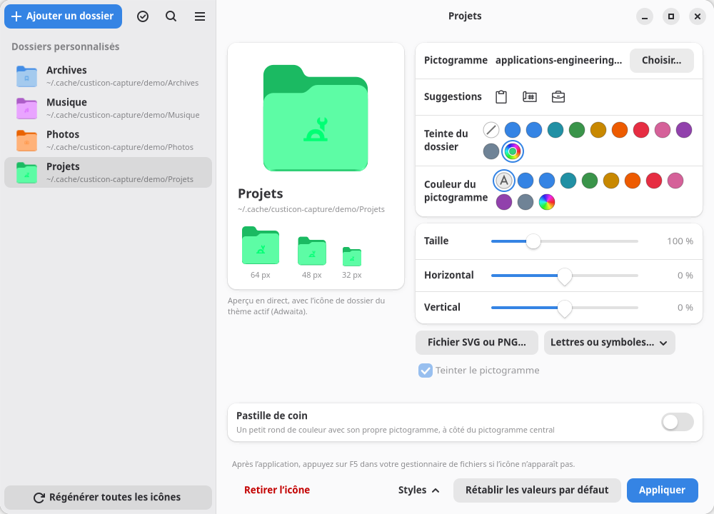
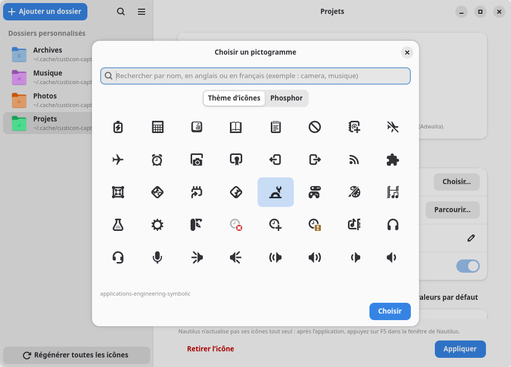
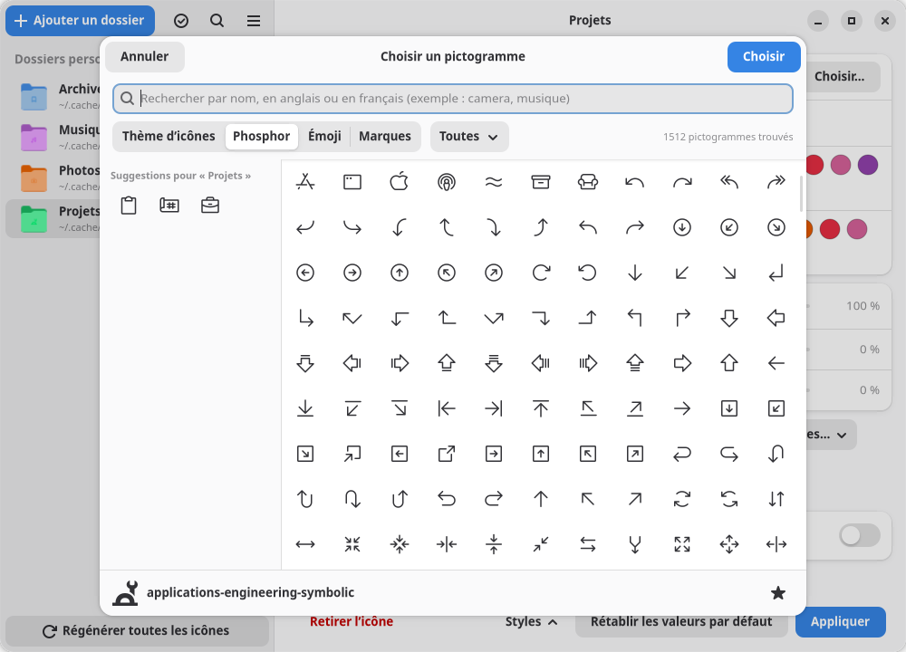
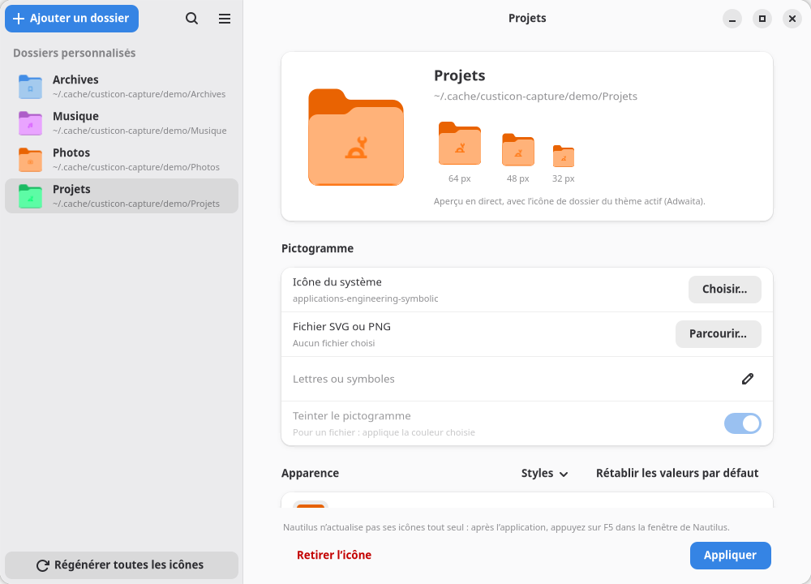
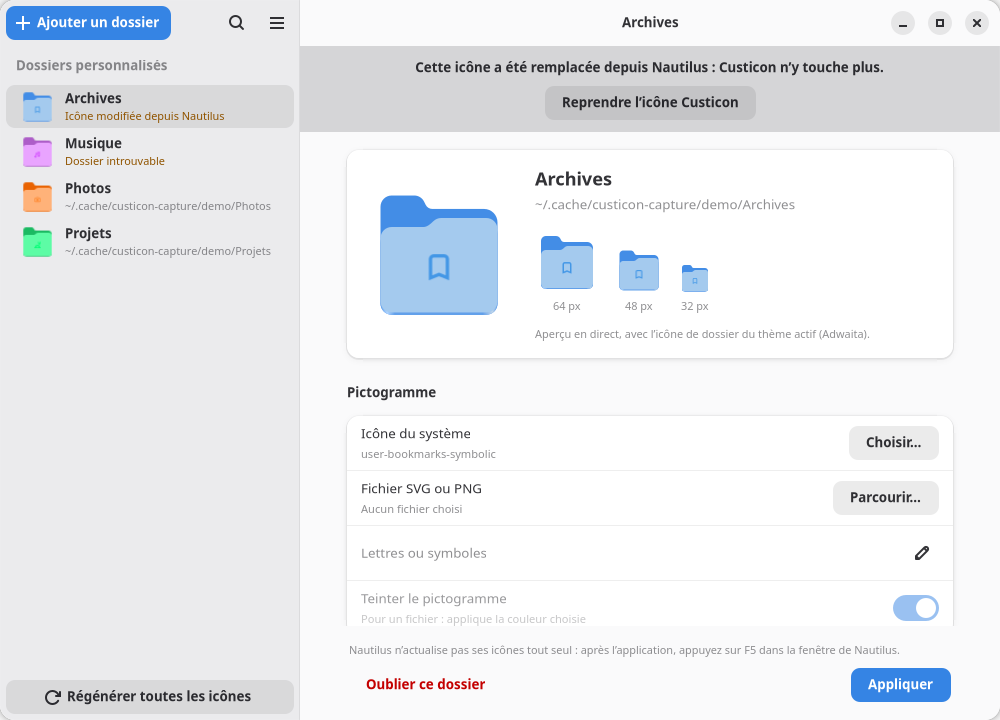

# Guide d’utilisation de Custicon

[English](../en/README.md) · **Français**

Custicon pose un pictogramme sur l’icône de dossier de votre thème, pour les dossiers de votre choix, et peut aussi
teinter le dossier lui-même. Ce guide décrit chaque étape.



## Sommaire

**Découvrir**
- [Premiers pas](#premiers-pas)
- [Choisir le pictogramme](#choisir-le-pictogramme)

**Utiliser**
- [Régler l’apparence](#régler-lapparence)
- [Appliquer et voir le résultat](#appliquer-et-voir-le-résultat)
- [Gérer ses dossiers](#gérer-ses-dossiers)
- [Retirer une icône](#retirer-une-icône)
- [Après un changement de thème](#après-un-changement-de-thème)

**Aller plus loin**
- [Aide, À propos et raccourcis clavier](#aide-à-propos-et-raccourcis-clavier)
- [Questions et réponses](#questions-et-réponses)

## Premiers pas

Au premier lancement, la fenêtre propose de choisir un dossier. Vous pouvez aussi utiliser
**Ajouter un dossier** en haut à gauche (Ctrl+O).

1. Choisissez le dossier à personnaliser. Il doit se trouver dans votre dossier personnel.
2. Le dossier apparaît dans la liste de gauche, avec l’icône de dossier de votre thème.
3. L’éditeur s’ouvre à droite. Le bouton **Appliquer** reste grisé tant qu’aucun pictogramme n’est choisi.

> [!NOTE]
> Choisir un dossier ne modifie rien. Rien n’est enregistré tant que vous n’avez pas appuyé sur **Appliquer**.

## Choisir le pictogramme

Quatre possibilités, dans le groupe **Pictogramme**.

### Une icône du système, ou d’un jeu fourni

**Icône du système** > **Choisir…** ouvre la liste des pictogrammes. Un sélecteur en haut passe d’une source à l’autre :

- **Thème d’icônes** : les pictogrammes de votre thème actif.
- **Phosphor** : 1 500 pictogrammes livrés avec Custicon (animaux, lieux, objets, symboles…).
- **Émoji** : environ 1 600 émoji monochromes (visages, animaux, nourriture, voyages, objets…). Ils se teintent comme n’importe quel pictogramme.
- **Marques** : plus de 3 400 logos (GitHub, Docker, Firefox…), pratiques pour les dossiers de projets. Les logos restent la propriété de leurs détenteurs.





- Tapez un mot dans le champ de recherche, en anglais ou en français. Les noms sont en anglais
  (par exemple `camera`, `music`, `folder`, `star`), mais Custicon connaît aussi des mots français
  (`maison`, `musique`, `étoile`, `photo`, `chat`, `voiture`…), sans tenir compte des accents ni des majuscules.
  La recherche reste en place quand vous changez de jeu.
- Cliquez sur un pictogramme puis sur **Choisir**, ou double-cliquez dessus.
- Si le thème actif ne fournit pas l’icône demandée, Custicon utilise celle d’Adwaita.
- Un pictogramme d’un jeu fourni est indiqué avec le nom du jeu après son nom, par exemple « camera (Phosphor) ».
  Ces jeux sont livrés avec Custicon : ils ne dépendent pas de votre thème et restent disponibles après un changement de thème.
- Les émoji ont des noms français et anglais : « chat » et « cat » trouvent tous deux les chats. Phosphor et le thème d’icônes
  comprennent aussi des mots français courants.

### Un fichier

**Fichier SVG ou PNG** > **Parcourir…** permet de prendre votre propre image.

- **Teinter le pictogramme** applique la couleur choisie à l’image. Pour un SVG, les couleurs
  d’origine sont remplacées ; pour un PNG, seule la forme (la transparence) est conservée.
- Désactivez la teinte pour garder les couleurs d’origine de l’image.

### Des lettres ou des symboles

**Lettres ou symboles** permet de taper 1 à 3 caractères (par exemple `Z`, `A1`, `é`) qui servent de pictogramme.
Ils sont dessinés en vectoriel et teintés comme n’importe quel pictogramme du thème. Un caractère que la police
ne sait pas dessiner est refusé avec un message. Choisir une icône ou un fichier efface le texte, et inversement.

## Régler l’apparence

Le groupe **Apparence** règle le rendu. L’aperçu en haut de l’éditeur montre le résultat
à quatre tailles, avec l’icône de dossier de votre thème actif.



- **Teinte du dossier** : trois choix.
  - **Aucune** : le dossier garde la couleur de votre thème d’icônes.
  - **Accent du système** : le dossier prend la couleur d’accent choisie dans les paramètres de GNOME.
  - **Personnalisée** : la pastille permet de choisir la couleur vous-même.

  Le relief du dossier (ses zones claires et sombres) est conservé, et le fichier du thème n’est jamais modifié.
  Un gris, un blanc ou un noir donne un dossier désaturé plutôt qu’une couleur franche.
- **Couleur** (du pictogramme) : trois choix.
  - **Automatique** : Custicon prend la couleur de la face du dossier, teinte comprise, et en déduit une couleur
    plus foncée, comme le font les dossiers Documents ou Musique.
  - **Accent du système** : la couleur d’accent choisie dans les paramètres de GNOME. Quand vous la changez,
    un bandeau propose de régénérer les icônes qui la suivent.
  - **Personnalisée** : la pastille permet de choisir la couleur vous-même.
- **Taille** : de 20 % à 300 % de la taille d’origine.
- **Position horizontale** et **Position verticale** : de -50 % à +50 %, depuis le centre de la face du dossier.
- **Rétablir les valeurs par défaut** remet l’absence de teinte, la couleur automatique, la taille et la position d’origine.

Les curseurs avancent par pas de 0,5 % (flèches du clavier ; Page précédente et Page suivante par pas de 5 %).
Ils s’élargissent avec la fenêtre, ce qui rend le réglage à la souris plus précis.

### Styles nommés

Le bouton **Styles** (à côté de **Rétablir les valeurs par défaut**) enregistre l’apparence actuelle sous un nom
(teinte du dossier, couleur, teinte du pictogramme, taille et positions, jamais le pictogramme). Un clic sur un style
l’applique au dossier en cours ; l’icône de corbeille le supprime. Les styles peuvent être échangés entre machines avec
**Exporter les styles…** et **Importer des styles…** dans le menu principal : un style importé remplace celui du même nom,
et les entrées non valides sont ignorées avec un décompte.

### Réglages retenus pour les prochains dossiers

À chaque **Appliquer**, Custicon retient l’apparence choisie : teinte du dossier, couleur (automatique ou non),
teinte, taille et positions. Le prochain dossier que vous ajoutez démarre avec ces réglages, que vous pouvez
modifier librement. Le pictogramme n’est jamais retenu, et les dossiers déjà personnalisés ne changent pas.
**Rétablir les valeurs par défaut** revient toujours aux valeurs d’origine de Custicon.

## Appliquer et voir le résultat

Appuyez sur **Appliquer**. Un message confirme l’opération.

> [!IMPORTANT]
> **Nautilus n’actualise pas ses icônes tout seul.** Appuyez sur **F5** dans la fenêtre de Nautilus
> pour voir le changement. Le même geste est nécessaire après un retrait ou une régénération.

## Gérer ses dossiers

La liste de gauche montre tous les dossiers personnalisés, par ordre alphabétique. Chaque dossier peut
afficher une alerte :



| Alerte | Signification | Que faire |
|---|---|---|
| Dossier introuvable | Le dossier a été supprimé, renommé ou déplacé. | **Retrouver le dossier…** (choisissez son nouvel emplacement) ou **Oublier ce dossier**. |
| Icône modifiée depuis Nautilus | Vous avez choisi une autre icône dans Nautilus. Custicon n’y touche plus. | **Reprendre l’icône Custicon**, ou **Oublier ce dossier**. |
| Fichier d’icône manquant | L’image générée a disparu. | **Régénérer l’icône**. |
| Métadonnées illisibles | Les métadonnées du dossier ne peuvent pas être lues. | Réessayer ou oublier le dossier. |

Quand la fenêtre redevient active, la liste se met à jour. Vos réglages en cours ne sont pas perdus.

### Chercher dans la liste

La loupe en haut de la liste (ou Ctrl+F) ouvre un champ de recherche : il filtre les dossiers par nom ou par chemin,
sans tenir compte des accents ni des majuscules.

### Ouvrir un dossier depuis Nautilus

Clic droit sur un dossier dans Nautilus, puis **Ouvrir avec Custicon**. Vous pouvez aussi glisser un dossier sur la fenêtre,
ou lancer `flatpak run io.github.gor3pig.Custicon /chemin/du/dossier`. Un seul dossier est ouvert à la fois,
et un fichier est refusé. Si Custicon tourne déjà, la même fenêtre est réutilisée.

## Retirer une icône

**Retirer l’icône** demande une confirmation. Le dossier retrouve l’icône qu’il avait avant Custicon :
aucune icône personnalisée, ou celle que vous aviez choisie vous-même dans Nautilus.
Le contenu du dossier n’est jamais touché.

Juste après un retrait, une notification propose **Annuler** pendant quelques secondes : l’icône est rétablie avec
ses réglages, même si le fichier du pictogramme a disparu entre-temps.

**Retirer toutes les icônes…** (menu principal) fait la même chose pour tous les dossiers, après confirmation, et affiche
un compte rendu. C’est la bonne précaution avant de désinstaller Custicon avec suppression des données.

**Oublier ce dossier** (pour un dossier introuvable ou dont vous avez changé l’icône) arrête simplement
le suivi, sans modifier l’icône actuelle.

## Après un changement de thème

Quand vous changez de thème d’icônes, les icônes déjà posées gardent l’ancien dossier. Un bandeau « Certaines icônes
ne correspondent plus à votre thème d’icônes ou à votre couleur d’accent » propose alors de les régénérer en un clic.
**Régénérer toutes les icônes** (bouton en bas de la liste, ou Ctrl+R) les recalcule avec le nouveau thème,
en gardant vos réglages, y compris la teinte du dossier. Un compte rendu indique ce qui a été mis à jour, ignoré ou introuvable.
Les dossiers dont vous avez changé l’icône depuis Nautilus sont ignorés.

Appuyez ensuite sur F5 dans Nautilus.

## Aide, À propos et raccourcis clavier

Le menu principal contient **Aide** (touche F1), qui ouvre ce guide dans la langue de votre bureau (français ou anglais),
et **À propos de Custicon**. La boîte « À propos » montre la version, les nouveautés de cette version (**Quoi de neuf**),
les liens d’assistance et de signalement d’un problème, les crédits et les licences, dont celle du jeu Phosphor.

| Raccourci | Action |
|---|---|
| Ctrl+O | Ajouter un dossier |
| Ctrl+R | Régénérer toutes les icônes |
| Ctrl+F | Chercher dans la liste des dossiers |
| F1 | Ouvrir l’aide |
| Ctrl+Q | Quitter |

## Questions et réponses

**Pourquoi dois-je appuyer sur F5 ?**
Nautilus lit les icônes personnalisées à l’ouverture d’un dossier et ne surveille pas leurs changements.
F5 recharge le contenu de la fenêtre.

**L’icône du dossier n’est pas celle de mon thème.**
Custicon utilise l’icône `folder` de votre thème actif, en suivant l’héritage entre thèmes.
Si votre thème ne fournit qu’un PNG, le résultat est en bitmap et peut paraître moins net à grande taille.

**La teinte du dossier ne donne pas exactement la couleur choisie.**
La teinte remplace la couleur du dossier en gardant son relief : les zones claires restent claires et les sombres restent
sombres. La couleur obtenue est donc proche de celle choisie, sans lui être identique. Un thème dont le dossier est très clair
ou très sombre donne un résultat plus pâle ou plus foncé.

**Comment sauvegarder mes réglages ou les copier sur une autre machine ?**
Les styles s’exportent depuis le menu principal. La liste des dossiers et les images générées sont dans
`~/.var/app/io.github.gor3pig.Custicon/data/custicon/` ; les chemins de dossiers étant propres à chaque machine,
la liste n’est pas faite pour être copiée telle quelle.

**Une lettre ou un symbole est refusé ?**
La police de Custicon ne sait pas dessiner ce caractère (les emoji en couleur ne sont pas pris en charge).
Essayez une lettre, un chiffre ou un symbole courant.

**Où sont rangées les images générées ?**
Dans l’espace de données de l’application (`~/.var/app/io.github.gor3pig.Custicon/data/custicon/`).
Une désinstallation avec suppression des données les efface : retirez d’abord les icônes.

**Comment Custicon se met-il à jour ?**
Si vous l’avez installé depuis `custicon.flatpakref`, l’application Logiciels propose chaque nouvelle version, ou lancez `flatpak update` ; les mises à jour sont signées.
Une copie installée depuis le fichier `.flatpak` d’une release ne se met pas à jour toute seule : désinstallez-la (`flatpak uninstall io.github.gor3pig.Custicon`)
puis installez-la de nouveau depuis le fichier `.flatpakref`, en gardant vos styles et vos dossiers personnalisés tant que vous n’ajoutez pas `--delete-data`.
Les commandes d’installation sont dans le [README](../../README.fr.md#installation).

**Pourquoi Custicon demande-t-il l’accès à mon dossier personnel ?**
Pour que Nautilus voie l’icône, Custicon doit connaître le vrai chemin du dossier. Il ne demande que la
**lecture** du dossier personnel : le contenu de vos dossiers ne peut pas être modifié par l’application,
et elle n’a aucun accès au réseau. L’icône est enregistrée par le service GVfs de votre session, hors du bac à sable.
Le magasin d’applications signale cette permission, car elle concerne tous vos fichiers en lecture.

**Custicon indique qu’il ne voit pas mon dossier personnel.**
L’accès a été retiré ou n’a pas été accordé. Autorisez-le dans les Paramètres (Applications, puis Custicon),
ou lancez dans un terminal :

```sh
flatpak override --user --filesystem=home:ro io.github.gor3pig.Custicon
```

puis relancez Custicon. Si le message revient, une surcharge de permissions retire peut-être l’accès : `flatpak override --user --show io.github.gor3pig.Custicon`
(et `flatpak override --show io.github.gor3pig.Custicon` pour la surcharge système) les affiche, et
`flatpak override --user --reset io.github.gor3pig.Custicon` supprime celles de votre utilisateur.
La commande `flatpak run --command=cat io.github.gor3pig.Custicon /.flatpak-info` montre ce que l’application voit réellement.

**Pourquoi ne peut-on choisir que les dossiers du dossier personnel ?**
Pour que Nautilus voie l’icône, Custicon doit écrire sur le vrai chemin du dossier. Les disques
externes ne sont pas pris en charge dans cette version.

**Mon dossier est choisi mais l’icône n’apparaît pas dans Nautilus.**
Appuyez sur F5. Si rien ne change, regardez si le dossier affiche une alerte dans la liste de Custicon.
